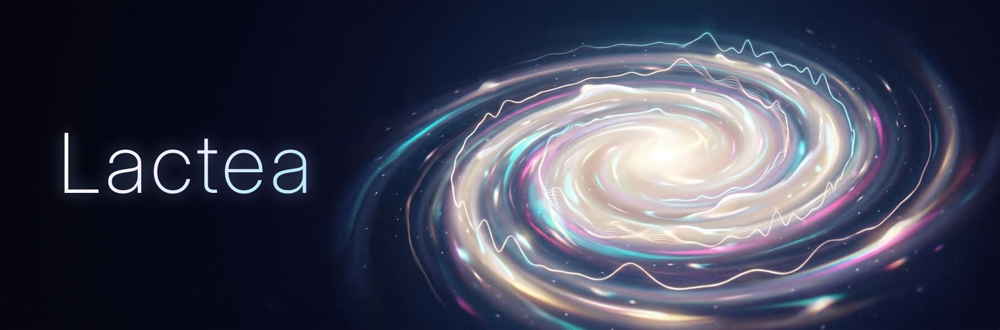

<p align="center"></p>

# Lactea

A pure-Rust MilkDrop 2 / projectM-compatible music visualizer built on wgpu (Vulkan, Metal, DX12,
GL, WebGPU). It ships as:

- **a library** (`lactea`) that renders into any wgpu texture the host provides. It opens no
  windows or audio devices and never touches the filesystem, so it also builds for the web;
- **a C library** (`lactea-capi`) for non-Rust hosts, including rendering into a host `VkImage`;
- **a standalone app** (`lactea-app`, binary `lactea`) with PipeWire "what you hear" capture, file
  playback and preset browsing.

## Features

- Reads the whole `.milk` format (versions 1 and 2, custom waves and shapes, per-frame and
  per-vertex code, warp and composite shaders) with MilkDrop 2, MilkDrop 3 or projectM semantics
  (`Compat::{ProjectM, MilkDrop2, MilkDrop3}`, see [`docs/md3.md`](docs/md3.md)).
- MilkDrop 3 (3.37) support behind `Compat::MilkDrop3`: `.milk2` double presets with the 30 blend patterns, preset
  sprites (11 blend modes, GIF), ns-eel2 expressions, `get_fft` / mouse / `q1..q64` shader inputs, wave modes 0..16
  and auto hard cuts; the whole MD3 pack loads (details and gaps: [`docs/md3.md`](docs/md3.md)).
- Native expression engine, HLSL-to-WGSL shader translator and JPEG decoder; no C dependencies.
- Soft and hard preset transitions, playlist/shuffle/history logic, projectM-style runtime parameters.
- Deterministic by construction: same preset, audio and seed give the same pixels.
- Rendering matches projectM to within PSNR ≥ 40 dB / SSIM ≥ 0.98 on 99.8 % of its 4169 comparable
  bundled presets, measured rather than eyeballed. Method, numbers and open issues:
  [`docs/fidelity.md`](docs/fidelity.md).

## Install

| platform | how |
|---|---|
| Linux x86_64 | tarball from the [releases](https://github.com/M0Rf30/lactea/releases) (`lactea`, `lib/liblactea_capi.{so,a}`, `include/lactea.h`, C examples, `.desktop`, icon) |
| Windows x86_64, macOS arm64 | zip / tarball from the releases |
| from source | `cargo install --path crates/lactea-app` |
| Rust library | `cargo add lactea` |

Build prerequisites on Linux: Rust ≥ 1.88, `libasound2-dev` (cpal) and, for the default PipeWire
capture, `libpipewire-0.3-dev` + `clang`. Without PipeWire (and on Windows/macOS) audio capture goes
through cpal:

```sh
cargo build --release -p lactea-app --no-default-features --features engine
```

Any Vulkan (Linux/Windows), Metal (macOS) or DX12 (Windows) driver works; lavapipe renders in
software.

## Standalone

```sh
lactea --dir /usr/share/projectM/presets
lactea --audio-file song.flac --preset foo.milk
```

Keys: N/→/Space next, P/← previous, R random, L lock, F/F11 fullscreen, Esc/Q quit. All options:
[`docs/app.md`](docs/app.md).

## Embedding

### Rust

```rust
use lactea::{Engine, EngineConfig, FrameClock, Transition};

let mut engine = Engine::new(&device, &queue, EngineConfig {
    width: 1280, height: 720, output_format: surface_format, ..Default::default()
});
engine.set_texture_provider(Box::new(my_textures)); // trait TextureProvider { load, random_pool }
engine.load_preset(&std::fs::read("preset.milk")?, "preset", Transition::Cut)?;
// later: blend into the next preset over 3 s (both keep running; projectM's soft cut)
// engine.load_preset(&next_bytes, "next", Transition::Soft { seconds: 3.0 })?;
// each frame:
engine.push_pcm_f32(&interleaved_f32, 2);
let mut enc = device.create_command_encoder(&Default::default());
engine.render(&mut enc, &target_view, FrameClock { time, frame });
queue.submit([enc.finish()]);
```

### WebAssembly

Library crates compile for `wasm32-unknown-unknown` (`cargo check -p lactea --target
wasm32-unknown-unknown`, covered by CI). The only native-only code, blocking on shader-validation
error scopes in `lactea-render`, is `cfg`-gated; on the web target user shaders are not
pre-validated by the engine (the browser reports validation errors asynchronously). Creating the
`wgpu` device/surface, audio capture and texture loading are the host's job.

`examples/web` is a complete browser host: a wasm-bindgen crate (`Demo::create(canvas)`,
`load_preset(milk, name, soft_seconds)`, `render(time, pcm)`, `snapshot(time, pcm)`) plus
`index.html` (two presets, synthetic 120 bpm PCM or the microphone, soft/hard cut buttons). It is
its own cargo workspace; CI runs `cargo check --locked` on it.

```sh
rustup target add wasm32-unknown-unknown
cargo install wasm-bindgen-cli --version 0.2.128   # must match examples/web/Cargo.lock
examples/web/build.sh serve                        # http://localhost:8000/ (secure context for WebGPU)
```

It needs a browser with WebGPU (Chrome/Edge 113+, recent Firefox/Safari).

### C / C++ (`lactea-capi`)

`crates/lactea-capi` builds `liblactea_capi.{so,dylib,dll}` + `.a`; its build script regenerates the header
`crates/lactea-capi/include/lactea.h` with cbindgen whenever the crate's sources change.

```c
#include "lactea.h"

LacteaConfig cfg;
lactea_config_default(&cfg);
cfg.width = 1280; cfg.height = 720;
LacteaEngine *e = lactea_create(&cfg);            /* own wgpu device; NULL on failure */
lactea_set_texture_dir(e, "/usr/share/projectM/textures");
lactea_load_preset(e, milk_bytes, milk_len, "name");
/* each frame: */
lactea_push_pcm_f32(e, pcm, frames, 2);           /* interleaved f32 */
lactea_render_to_buffer(e, time_s, frame_no, rgba, w * h * 4);  /* tight RGBA8, row 0 = top */
/* lactea_render(e, t, n) renders without read-back; lactea_resize(); lactea_destroy(e); */
fprintf(stderr, "%s\n", lactea_last_error());    /* thread-local message of the last failure */
```

Fallible calls return `LacteaStatus` (`0` ok, negative on error). Nothing unwinds across the C
boundary. A handle is single-threaded. A complete host is
`crates/lactea-capi/examples/c/minimal.c`; `cargo test -p lactea-capi` compiles it with the system
`cc`, renders 10 frames and fails if the last one is black.

```sh
cc minimal.c -Iinclude -Ltarget/release -llactea_capi -lm -Wl,-rpath,target/release -o minimal
```

projectM-equivalent calls (`lactea_push_pcm_i16/u8`, `lactea_set_mesh_size`, `lactea_set_fps`,
`lactea_set_texel_offset`, `lactea_{get,set}_switch_settings`, `lactea_poll_switch_request`,
`lactea_load_idle_preset`, ...) and their mapping to `projectm_*` are listed in
[`docs/parity.md`](docs/parity.md).

**Preset changes.** `lactea_load_preset` cuts at once; `lactea_load_preset_ex(e, bytes, len, name,
seconds)` is the soft cut: `seconds > 0` blends the running and the new preset over that time
(projectM's default is 3 s; `0` cuts; negative or NaN is `LACTEA_STATUS_INVALID_ARGUMENT`). A failed
load leaves the running preset alone. The host learns *when* to change by polling
`lactea_poll_switch_request(e, &is_hard_cut)` or through a callback, and *that a load failed*
through a second one; both run on the calling thread inside the C call and must not call back into
the same handle:

```c
static void on_request(bool is_hard_cut, void *user) { /* pick the next preset, then: */ }
static void on_failed(const char *preset, const char *message, void *user) { /* log, skip */ }
lactea_set_switch_requested_callback(e, on_request, user);   /* fired from lactea_render*() */
lactea_set_switch_failed_callback(e, on_failed, user);       /* fired from lactea_load_*() */
lactea_load_preset_ex(e, next, next_len, "next", 3.0);       /* soft cut over 3 s */
```

**Vulkan interop.** A Vulkan host can let lactea render into its own `VkImage` instead of reading
pixels back. The engine then runs on the *host's* `VkDevice` (a foreign image cannot be used from
another device), so the host asks lactea what that device must enable, creates it, and hands it
over (`crates/lactea-capi/src/vulkan.rs` has the full contract, `examples/c/vulkan.c` is a working
host):

```c
LacteaVulkanHost host = { .get_instance_proc_addr = (const void *)vkGetInstanceProcAddr,
    .instance = instance, .physical_device = pd, .queue_family_index = family, .api_version = api,
    .instance_extensions = inst_exts, .instance_extension_count = n,
    .image_format = VK_FORMAT_R8G8B8A8_UNORM };        /* or B8G8R8A8_UNORM */
LacteaVulkanRequirements *req;
lactea_vulkan_requirements(&host, &req);               /* extensions + feature chain for vkCreateDevice */
/* vkCreateDevice(.. pNext = req->device_pnext, pEnabledFeatures = req->enabled_features,
                     extensions = req->device_extensions ..) */
host.device = device; host.device_extensions = req->device_extensions;
host.device_extension_count = req->device_extension_count;
LacteaEngine *e = lactea_create_vulkan(&cfg, &host);   /* cfg.width/height = image size */
lactea_render_to_vk_image(e, (uint64_t)image, time_s, frame_no, /*wait=*/true);
/* image is now in COLOR_ATTACHMENT_OPTIMAL; destroy the engine before the VkDevice */
```

Requirements: the instance's `apiVersion` must be at least the physical device's (use
`vkEnumerateInstanceVersion`; lactea checks and refuses otherwise) and `VK_KHR_get_physical_device_properties2`
enabled; the image needs `COLOR_ATTACHMENT` usage and the engine's size. lactea submits to the
queue the host names, so ordering on that queue plus a `COLOR_ATTACHMENT_OUTPUT` barrier is enough;
`wait = true` blocks until the GPU is done (any queue may then use the image). Vulkan engines have no
internal target (`lactea_render*` refuse). `cargo test -p lactea-capi` builds and runs the host
(RGBA8 and BGRA8) when the Vulkan headers are installed (`vulkan-headers` / `libvulkan-dev`, or
`VULKAN_INCLUDE_DIR`); it renders into an image on the first device the loader offers and fails on a
black read-back. On Apple targets the entry points exist and report `LACTEA_STATUS_GPU`; Metal and
Direct3D hosts use the Rust `wgpu` API directly.

## Crates

| crate | role | crates.io |
|---|---|---|
| [`lactea`](crates/lactea) | engine: preset + expressions + audio + shaders driving the renderer | yes |
| [`lactea-render`](crates/lactea-render) | wgpu port of the MilkDrop 2 frame pipeline; renders into a host texture | yes |
| [`lactea-preset`](crates/lactea-preset) | `.milk` parser with MilkDrop 2 quirks | yes |
| [`lactea-eel`](crates/lactea-eel) | ns-eel2 / projectm-eval compatible expression language | yes |
| [`lactea-hlsl`](crates/lactea-hlsl) | MilkDrop HLSL to WGSL translator | yes |
| [`lactea-audio`](crates/lactea-audio) | bass/mid/treb, waveform and spectrum analysis | yes |
| [`lactea-jpeg`](crates/lactea-jpeg) | JPEG decoder byte-identical to `stb_image` | yes |
| [`lactea-abi`](crates/lactea-abi) | shared contract: shader constants, bindings, dump layout | yes |
| `lactea-compare` | dump reader/writer, PSNR/SSIM/variable diffs, `fdcompare` CLI | no (repo tooling) |
| `lactea-capi` | C ABI (cdylib + staticlib, cbindgen header) | no, released as binaries |
| `lactea-app` | standalone app | no, released as binaries |
| `lactea-cli` | `fdrender`: deterministic dumps for fidelity work | no |
| `lactea-eel-oracle` | differential tests against projectm-eval | no |

Architecture and contracts: [`docs/ARCHITECTURE.md`](docs/ARCHITECTURE.md).

## Releases

Versions, `CHANGELOG.md` and crates.io publishing are driven by [release-plz](https://release-plz.dev)
from conventional commits. Merging its release PR tags `vX.Y.Z`; the tag builds the app and the C
library for Linux, Windows and macOS (`.github/workflows/release.yml`) and attaches the archives
and `SHA256SUMS` to the GitHub release.

## Contributing

See [`CONTRIBUTING.md`](CONTRIBUTING.md).

## License

Dual-licensed under [MIT](LICENSE-MIT) or [Apache-2.0](LICENSE-APACHE), at your option. MilkDrop 2
(BSD-3-Clause, Nullsoft) parts and other attributions: [`THIRD_PARTY_NOTICES.md`](THIRD_PARTY_NOTICES.md).
